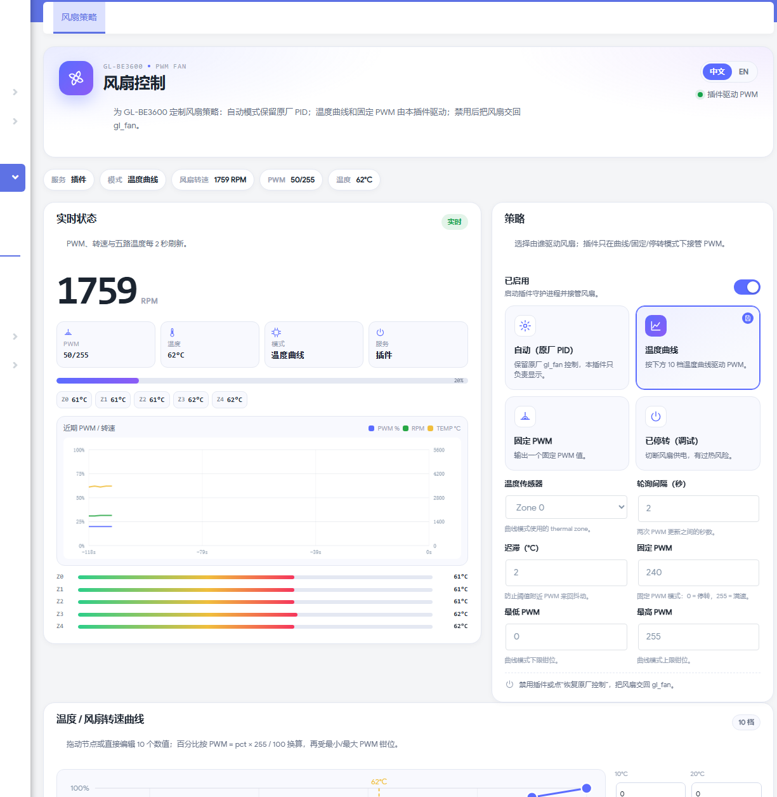
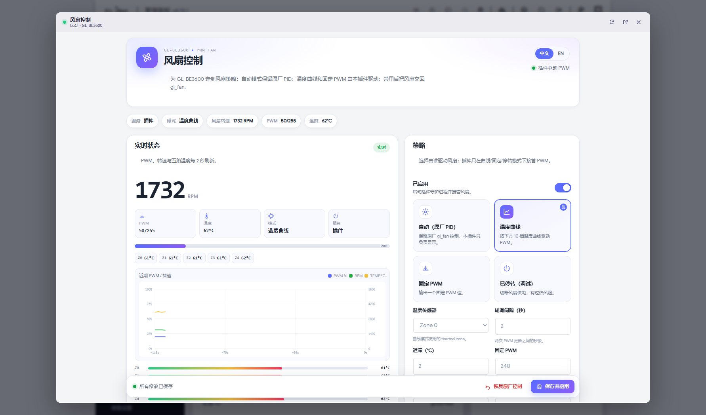

# Fan Control / 风扇控制

[中文](README.zh-CN.md) · [English](README.en.md) · [Back to overview](../../README.md)

> **Open source / research & study project**  
> This is a community project, not an official GL.iNet firmware or plugin. Flashing, rooting and modifying the OEM admin panel can damage your device. Back up first and use at your own risk. Follow local laws and the GL.iNet / OpenWrt / LuCI licenses.


`luci-app-glfanctl` **1.0.4-1** — PWM fan control for GL-BE3600 with OEM PID, temperature curve, fixed PWM and stop modes; live curves, five temperature zones and independent save.

---

## Screenshots





---

## Features

- Large RPM reading and PWM progress bar;
- Five temperature zones (Z0–Z4) with bar indicators;
- PWM / RPM / TEMP live chart;
- 10-point temperature / fan-speed curve editor (drag or type);
- Current-temperature dashed marker;
- Four modes: OEM PID / temperature curve / fixed PWM / stop;
- Configurable thermal zone, poll interval, hysteresis, min/max PWM;
- Independent save bar, applied immediately, no LuCI global dirty state;
- Restores `gl_fan` when disabled.

---

## Compatibility

Tested on:

- GL.iNet GL-BE3600 (IPQ5332)
- GL.iNet 4.10.1 (OpenWrt 23.05-SNAPSHOT)
- LuCI Master / Argon
- OEM `gl_fan` / PWM sysfs

Other firmware versions may need adjustments.

---

## Install

```sh
scp releases/luci-app-glfanctl_1.0.4-1_aarch64_cortex-a53_neon-vfpv4.ipk root@192.168.8.1:/tmp/

ssh root@192.168.8.1
opkg install --force-depends --force-reinstall --force-overwrite \
  /tmp/luci-app-glfanctl_1.0.4-1_aarch64_cortex-a53_neon-vfpv4.ipk

rm -f /tmp/luci-indexcache*
/etc/init.d/uhttpd restart
```

Open:

```text
http(s)://192.168.8.1/cgi-bin/luci/admin/services/glfanctl/main
```

> The packages are unsigned, hence `--force-depends` / `--force-overwrite`.  
> Use stop/fixed PWM with care; always keep a temperature safety margin.

### Restore OEM

- Fan page: **Restore OEM control**;
- or `opkg remove luci-app-glfanctl`.

---

## Modes

| Mode | Description |
|---|---|
| Auto (OEM PID) | Keep OEM `gl_fan` in control; this plugin only displays |
| Temperature curve | 10-point curve drives PWM; plugin takes over |
| Fixed PWM | Output one fixed PWM value; plugin takes over |
| Stop (debug) | Cut fan power — **overheating risk** |

### Parameters

- Thermal zone
- Poll interval (seconds)
- Hysteresis (°C)
- Fixed PWM (0–255)
- Min / max PWM
- 10-point curve from 10–100°C

> In curve mode `PWM = pct × 255 / 100`, then clamped to min/max PWM.

---

## GL.iNet gl-ui entry

The square expand button in the Overview CPU card is provided by **`luci-app-glanim` 1.3.3+** (screen plugin); the fan package itself does not ship the gl-ui bridge.

To use the OEM entry, install both:

- `luci-app-glanim 1.3.3-1`
- `luci-app-glfanctl 1.0.4-1`

---

## Build from source

From the repository root:

```sh
python build/build_ipk.py fan-control
```

Output: `plugins/fan-control/releases/luci-app-glfanctl_1.0.4-1_....ipk`

Layout:

```text
plugins/fan-control/
├── README.md
├── README.zh-CN.md
├── README.en.md
├── images/
├── releases/
└── src/                 # glfanctl package source
```

---

## License & disclaimer

- Code: [MIT](../../LICENSE)
- Risk notice: [DISCLAIMER.md](../../DISCLAIMER.md)
- Changelog: [CHANGELOG.md](../../CHANGELOG.md)

GL.iNet, LuCI, OpenWrt and their trademarks/firmware assets belong to their respective owners. This repository does not contain GL.iNet closed-source firmware code.
