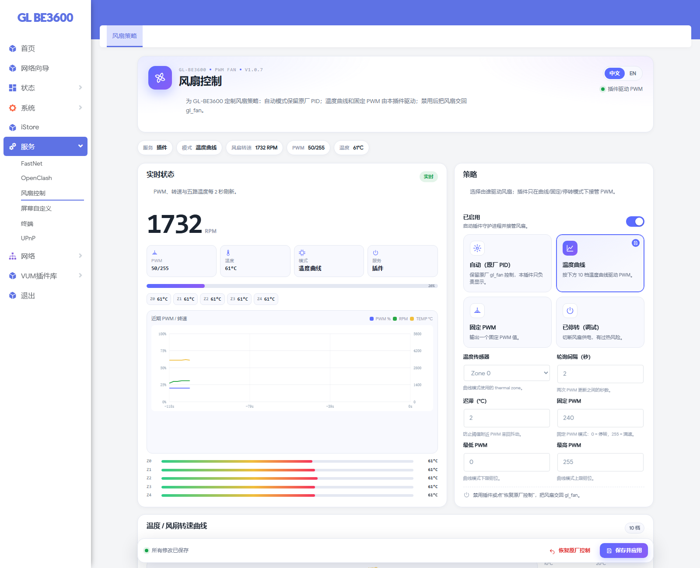

# 风扇控制 / Fan Control

[中文](README.zh-CN.md) · [English](README.en.md) · [返回总览](../../README.md)

作者：**@xavierbe278** · GitHub：[gl-be3600-toolbox](https://github.com/xavierbe278/gl-be3600-toolbox)

> **开源 / 研究学习项目**  
> 本项目以开源方式发布，主要用于个人研究、学习和自用。它不是 GL.iNet 官方固件或官方插件，不提供任何担保；刷机、root、修改原厂管理面板均有风险，请先备份并自行承担后果。请遵守当地法律法规以及 GL.iNet / OpenWrt / LuCI 的许可协议。


`luci-app-glfanctl` **1.0.7-1**：GL-BE3600 PWM 风扇控制，支持原厂 PID、温度曲线、固定 PWM、停转四种模式，带实时曲线、五路温度和独立保存。

---

## 截图



---

## 功能

- 大号 RPM 主读数、PWM 进度条；
- 五路温度芯片（Z0–Z4）与温度分区进度条；
- PWM / RPM / TEMP 实时曲线；
- 温度 / 转速曲线编辑器，10 档温度点，支持拖动或直接输入；
- 当前温度虚线标记；
- 四种模式：自动（原厂 PID）/ 温度曲线 / 固定 PWM / 停转；
- 温区、轮询间隔、迟滞、最小/最大 PWM 可调；
- 独立保存栏，保存即应用，不污染 LuCI 全局表单；
- 禁用/恢复原厂时切回 `gl_fan`。

---

## 兼容性

实测环境：

- GL.iNet GL-BE3600（IPQ5332）
- GL.iNet 4.10.1（OpenWrt 23.05-SNAPSHOT）
- LuCI Master / Argon 主题
- 原厂 `gl_fan` / PWM sysfs

不同固件版本可能需要调整。

---

## 安装

```sh
scp releases/luci-app-glfanctl_1.0.7-1_aarch64_cortex-a53_neon-vfpv4.ipk root@192.168.8.1:/tmp/

ssh root@192.168.8.1
opkg install --force-depends --force-reinstall --force-overwrite \
  /tmp/luci-app-glfanctl_1.0.7-1_aarch64_cortex-a53_neon-vfpv4.ipk

rm -f /tmp/luci-indexcache*
/etc/init.d/uhttpd restart
```

打开：

```text
http(s)://192.168.8.1/cgi-bin/luci/admin/services/glfanctl/main
```

> 安装包未签名，所以使用 `--force-depends` / `--force-overwrite`。  
> 风扇“停转”“固定 PWM”请谨慎设置，务必保留温度保护。

### 恢复原厂

- 风扇页：**恢复原厂控制**；
- 或：

```sh
opkg remove luci-app-glfanctl
```

---

## 模式

| 模式 | 说明 |
|---|---|
| 自动（原厂 PID） | 保留 OEM `gl_fan` 控制，本插件只负责显示 |
| 温度曲线 | 使用 10 档温度曲线驱动 PWM，插件接管 |
| 固定 PWM | 输出一个固定 PWM 值，插件接管 |
| 停转（调试） | 切断风扇供电，**有过热风险** |

### 参数

- 温度传感器（thermal zone）
- 轮询间隔（秒）
- 迟滞（°C）
- 固定 PWM（0–255）
- 最低 / 最高 PWM
- 10 档温度曲线：10–100°C，每档百分比

> 曲线模式下 `PWM = pct × 255 / 100`，再钳制到最低/最高 PWM。

---

## GL.iNet 原厂面板入口

“概览”CPU 卡片右上角的方形展开按钮由 **屏幕插件 `luci-app-glanim` 1.3.3+** 提供，风扇插件本身不包含 gl-ui 桥接。

想使用原厂面板入口时，请同时安装：

- `luci-app-glanim 1.3.3-1`
- `luci-app-glfanctl 1.0.7-1`

---

## 从源码构建

在仓库根目录执行：

```sh
python build/build_ipk.py fan-control
```

产物：`plugins/fan-control/releases/luci-app-glfanctl_1.0.7-1_....ipk`

结构：

```text
plugins/fan-control/
├── README.md
├── README.zh-CN.md
├── README.en.md
├── images/
├── releases/
└── src/                 # glfanctl 包源码
```

---

## 许可证与免责声明

- 代码：[MIT](../../LICENSE)
- 风险说明：[DISCLAIMER.md](../../DISCLAIMER.md)
- 变更记录：[CHANGELOG.md](../../CHANGELOG.md)

GL.iNet、LuCI、OpenWrt 及相关商标、固件资源归各自权利人所有；本项目不包含 GL.iNet 闭源固件代码。
