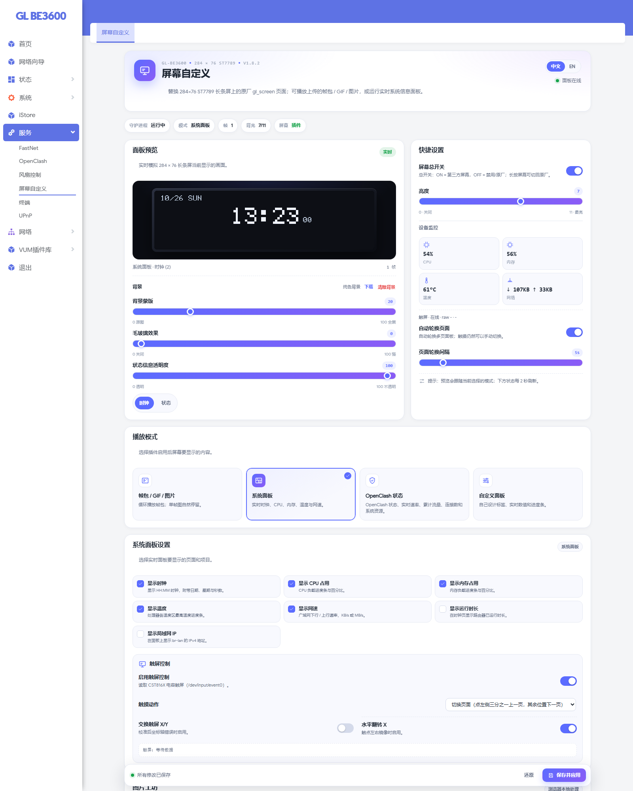
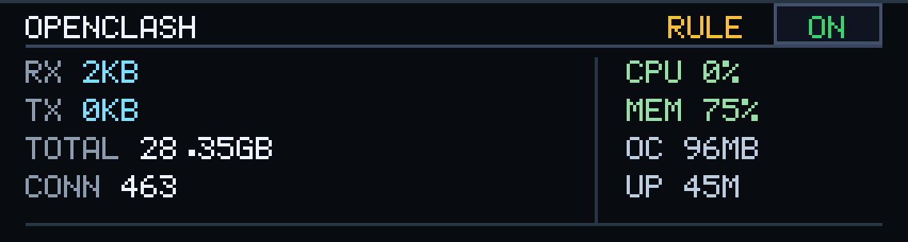
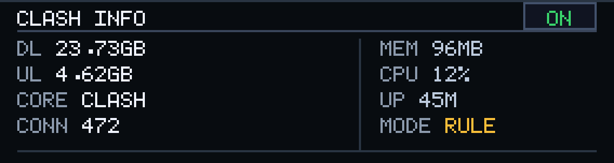
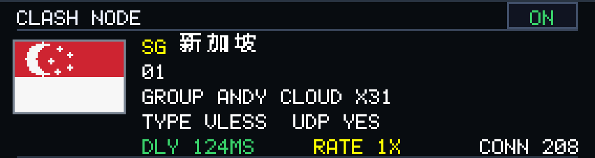
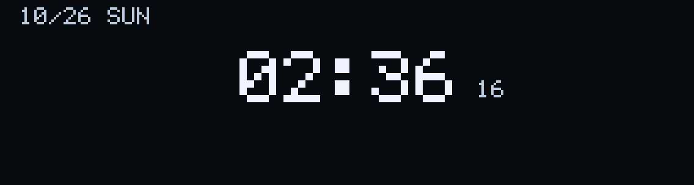
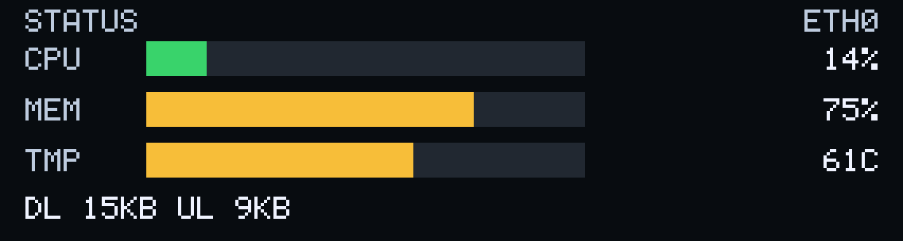
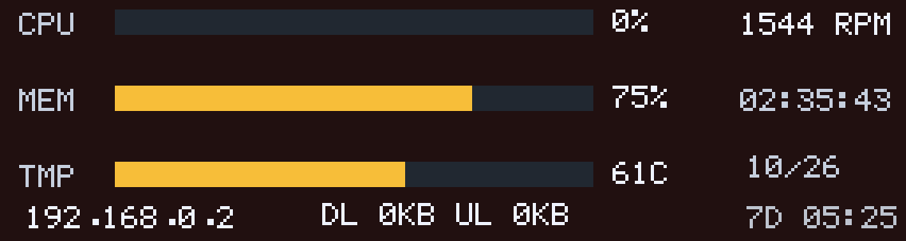
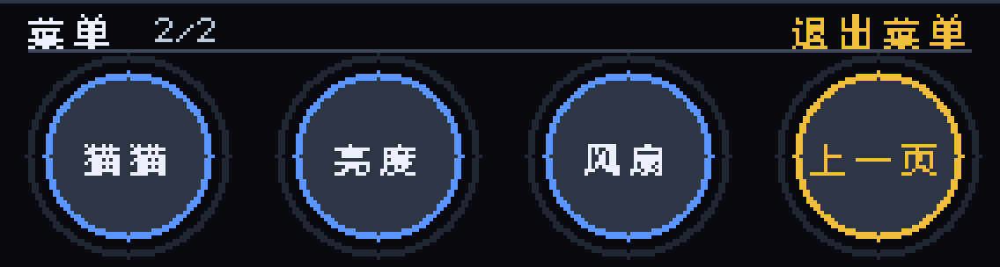

# 屏幕自定义 / Screen Custom

[中文](README.zh-CN.md) · [English](README.en.md) · [返回总览](../../README.md)

作者：**@xavierbe278** · GitHub：[gl-be3600-toolbox](https://github.com/xavierbe278/gl-be3600-toolbox)

> **开源 / 研究学习项目**  
> 本项目以开源方式发布，主要用于个人研究、学习和自用。它不是 GL.iNet 官方固件或官方插件，不提供任何担保；刷机、root、修改原厂管理面板均有风险，请先备份并自行承担后果。请遵守当地法律法规以及 GL.iNet / OpenWrt / LuCI 的许可协议。


`luci-app-glanim` **1.9.6-1**：为 GL-BE3600 的 284×76 ST7789 长条屏提供 帧包 / GIF / 图片、系统面板、OpenClash 状态/详情/节点、可视化自定义面板，并可选挂接 GL.iNet 原厂管理面板。

---

### OpenClash、字体包与物理开关

- OpenClash 状态页：ON/OFF、代理模式、实时上下行、累计流量、连接数、CPU/内存；
- OpenClash 三页：状态 / 详情 / 节点（国家旗帜、中文国家名、节点类型、延迟、倍率、UDP、连接数）；
- 屏幕右上角 ON/OFF 触摸按钮，可直接启动/停止 OpenClash；
- 多页自动轮换，间隔可设 2–30 秒；点击预览 Tab 会锁定页面并关闭自动轮换。
- 字体包：经典 5×7 / 粗体 5×7 / 紧凑 4×7；
- 物理拨动开关：ON = glanim，OFF = 原厂 `gl_screen`（挂接 `/etc/rc.button/switch`）；
- 自定义背景预览改为加载真实背景帧，不再空白或被拉伸。

## 截图

插件页面：



屏幕页面效果：









---

## 功能

- **GIF 循环**：浏览器端解码 GIF，逐帧上传，最多 **600 帧**（按总像素预算自动降采样）；
- **视频循环**：MP4(H.264) / WebM 在浏览器端逐帧提取，最多 **600 帧 / 60 秒**，选择 GIF 循环模式播放；
- **静态图片**：JPG / PNG / GIF / BMP，Cover / Contain / Stretch，1–3× 缩放；
- **幻灯片**：多帧图片按顺序播放，停在最后一帧；
- **系统面板**：时钟、CPU、内存、温度、网络、运行时长、IP，支持触摸翻页；
- **自定义面板**：在 284×76 画布上自由摆放标签、数值、进度条、矩形、分隔线；
- **背景媒体**：纯色 / 图片 / GIF / MP4 背景，布局元素绘制在背景之上；
- **网页截图导入**：直接图片/GIF URL；网页链接可通过 WordPress mShots 生成 1280×960 截图后导入；
- 5×7 方块点阵字库，屏幕文字高对比度；
- 独立保存、实时预览、图片工坊、原子帧包校验；
- 可选 GL.iNet 原厂面板集成（见下文）；
- 停用/卸载时恢复原厂 `gl_screen`。

---

## 兼容性

实测环境：

- GL.iNet GL-BE3600（IPQ5332）
- GL.iNet 4.10.1（OpenWrt 23.05-SNAPSHOT）
- LuCI Master / Argon 主题
- 284×76 ST7789，`/dev/fb0`，RGB565 little-endian，`fb90m`
- 可选：gl-ui v4.10.1 + `glinjector 3.0.5`

不同固件版本/屏幕批次可能需要调整。

---

## 安装

```sh
scp releases/luci-app-glanim_1.9.6-1_aarch64_cortex-a53_neon-vfpv4.ipk root@192.168.8.1:/tmp/

ssh root@192.168.8.1
opkg install --force-depends --force-reinstall --force-overwrite \
  /tmp/luci-app-glanim_1.9.6-1_aarch64_cortex-a53_neon-vfpv4.ipk

rm -f /tmp/luci-indexcache*
/etc/init.d/uhttpd restart
```

打开：

```text
http(s)://192.168.8.1/cgi-bin/luci/admin/services/glanim/main
```

> 安装包未签名，所以使用 `--force-depends` / `--force-overwrite`。  
> 升级前建议备份 `/etc/config/glanim` 和 `/usr/share/glanim/frames/`。

### 恢复原厂

- 屏幕页：**恢复原厂屏幕**；
- 或：

```sh
opkg remove luci-app-glanim
```

`prerm` 会停止插件、恢复 `gl_screen`，并移除 gl-ui 桥接挂接。

---

## 使用

### 播放模式

| 模式 | 说明 |
|---|---|
| `gif` | GIF / 视频帧包循环，按 manifest 延迟播放 |
| `still` | 静态图片，停留在一帧 |
| `slideshow` | 幻灯片，播放一遍后停在最后一帧 |
| `dashboard` | 系统面板：时钟页 + CPU/内存/温度/网络页 |
| `custom` | 自定义面板：用户自由布局 |

### 自定义面板数据源

| `source` | 内容 | 示例 |
|---|---|---|
| `cpu` | CPU 占用 % | `19` |
| `mem` | 内存占用 % | `72` |
| `temp` | SoC 最高温度 °C | `63` |
| `fan_rpm` | 风扇转速 | `1228` |
| `fan_pwm` | 风扇 PWM % | `14` |
| `rx` / `tx` | 当前下行/上行速率，自动格式化 | `5KB` / `1.2MB` |
| `net` | 组合网速文本 | `DL 5KB UL 2KB` |
| `clock` | 24 小时时钟 | `21:54:02` |
| `hm` | 时分 | `21:54` |
| `date` | 月/日 | `10/25` |
| `weekday` | 星期缩写 | `SAT` |
| `uptime` | 运行时长 | `7d 00:43` |
| `ip` / `lan_ip` | LAN IPv4 | `192.168.8.1` |
| `wan_ip` | WAN IPv4 | `192.168.0.2` |
| `iface` | WAN 网卡名 | `eth0` |
| `hostname` | 主机名 | `GL-BE3600` |

元素类型：`text`、`value`、`bar`、`rect`、`line`。进度条支持 `cpu`、`mem`、`temp`、`fan_pwm`。

> 屏幕使用内置 5×7 点阵字库，只显示大写英文、数字和符号，中文不会上屏。  
> 自定义布局以 JSON 保存在 `glanim.globals.custom_layout`，最多 40 个元素。

### 背景媒体

1. 在图片工坊载入图片 / GIF / MP4；
2. 点击 **设为自定义背景**；
3. 背景帧保存到 `/usr/share/glanim/custom_bg/`，布局元素绘制在背景之上；
4. 背景行的 **清除背景** 恢复纯色。

背景动画默认 **8 fps**，可在 UCI 调整：

```sh
uci set glanim.globals.custom_bg_fps='8'   # 1..15
uci commit glanim
/etc/init.d/glanim restart
```

> 8 fps 实测约占用单核 15%；更在意 CPU 可降到 4–6 fps。

### 视频

- 支持 MP4(H.264) / WebM；
- 浏览器逐帧提取，最多 **600 帧 / 60 秒**，默认 10 fps 采样；
- 选择 **GIF 循环** 模式即可循环播放；
- 不处理音频；
- H.265/HEVC 需先转 H.264 MP4 或 WebM。

### 帧数上限

| 通道 | 上限 | 说明 |
|---|---|---|
| 浏览器 GIF / 视频帧包 | **600 帧** | 源图长边缩到 480px，按 24MP 总像素预算自动降采样 |
| 自定义背景 | **300 帧** | 背景服务单独限制，保存时裁剪 |
| PC 帧包 / 手动上传 | **600 帧** | 单帧 43168 字节，600 帧约 25.9 MB |
| 上传包大小 | 32 MB | 控制器与 tar 包双重校验 |
| 自定义布局元素 | 40 个 | 后端与守护进程双重裁剪 |

### 网页 / 图片 URL

- 直接图片/GIF URL：路由器下载，浏览器解码，之后可裁剪、应用；
- 网页链接：勾选“网页截图”，通过 WordPress mShots 生成 1280×960 截图后导入；
- 网页截图是**一次性导入**。

> **没有实现完整的 HTML 渲染。** 路由器上跑浏览器内核需要数百 MB 存储/内存，持续渲染 CPU 开销很大，不适合常驻屏幕服务。若网页本身能输出监控图片（PNG/JPEG），把图片 URL 当背景/帧包使用即可。

---

## GL.iNet 原厂面板集成

安装本插件时，`postinst` 会：

1. 在 `/www/gl_home.html` 末尾追加桥接脚本；
2. 在 `/etc/glinjector/core.js` 末尾追加加载器（如果安装了 glinjector）。

效果：

- **系统 → 显示管理**：底部增加“屏幕自定义”卡片；
- **系统 → 概览**：CPU 卡片右上角增加方形展开按钮（风扇控制入口）；
- 点击后在同一页面内打开完整 LuCI 插件窗口；
- 卸载/升级时自动移除挂接。

> 这是对闭源 gl-ui DOM 的增强，不是官方扩展 API；GL.iNet 大版本改结构后可能需要调整。  
> 单独升级 `glinjector` 后入口消失，重装一次本插件即可恢复。  
> 如果弹窗显示 LuCI 登录页，先在 LuCI 登录一次。

---

## 从源码构建

在仓库根目录执行：

```sh
python build/build_ipk.py screen-custom
```

产物：`plugins/screen-custom/releases/luci-app-glanim_1.9.6-1_....ipk`

结构：

```text
plugins/screen-custom/
├── README.md
├── README.zh-CN.md
├── README.en.md
├── images/
├── releases/
├── src/                 # glanim 包源码
└── tools/glanim-convert.py
```

PC 端 GIF → 帧包：

```sh
python plugins/screen-custom/tools/glanim-convert.py input.gif -o my-pack.tar.gz --max-frames 600
```

---

## 许可证与免责声明

- 代码：[MIT](../../LICENSE)
- 风险说明：[DISCLAIMER.md](../../DISCLAIMER.md)
- 变更记录：[CHANGELOG.md](../../CHANGELOG.md)

GL.iNet、LuCI、OpenWrt 及相关商标、固件资源归各自权利人所有；本项目不包含 GL.iNet 闭源固件代码。
